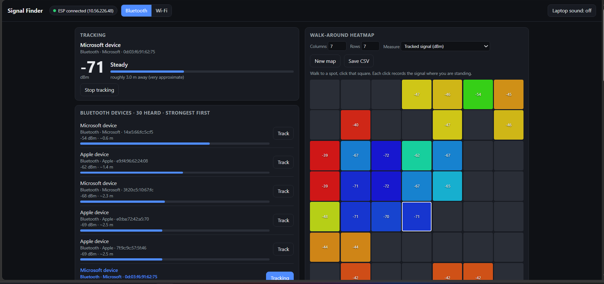
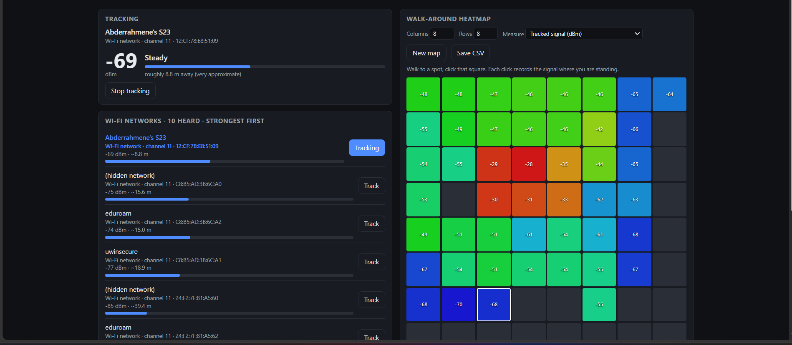

# ESP32 BLE / Wi-Fi Signal Finder

Handheld signal finder built on a Seeed XIAO ESP32S3. The ESP scans Bluetooth LE devices or Wi-Fi networks and streams RSSI to a laptop over UDP. The laptop shows a live list, beeps faster as you get closer to a tracked device, and builds a heatmap as you walk around.

## How it works

- `firmware/ble_finder/ble_finder.ino`: scans with NimBLE (BLE) or Wi-Fi beacons, smooths RSSI, and sends the strongest devices to the laptop every 300 ms. When tracking a Wi-Fi network it only scans that channel.
- `laptop/finder.py`: receives reports on UDP 4210, sends commands on 4211, and serves `finder_page.html` locally. Standard library only.
- Distance is a rough path-loss estimate, just for reference.

BOOT button: short press toggles BLE / Wi-Fi, hold 1 s to track the strongest signal. The LED is on when connected to the laptop.

## Setup

1. Arduino IDE 2.x, **esp32 by Espressif** 3.x, **NimBLE-Arduino** 2.x. Board: XIAO_ESP32S3.
2. Turn on Windows Mobile Hotspot (2.4 GHz). Put its name and password in `WIFI_SSID` / `WIFI_PASS`, then upload.
3. Run `python laptop/finder.py`. It opens a temporary firewall rule for UDP 4210 and removes it on exit (`--no-firewall` to skip this).

Try it without hardware: `python laptop/finder.py --simulate`

Sample heatmap exports are in `data/`.
